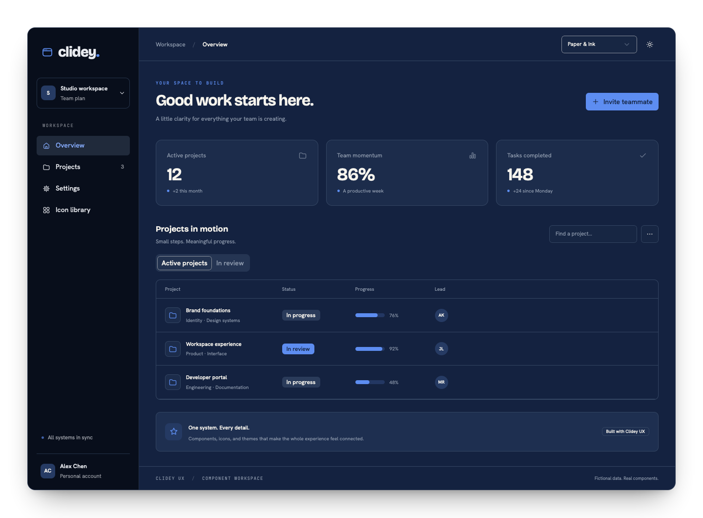
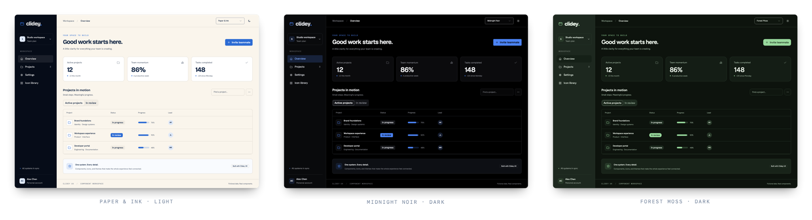
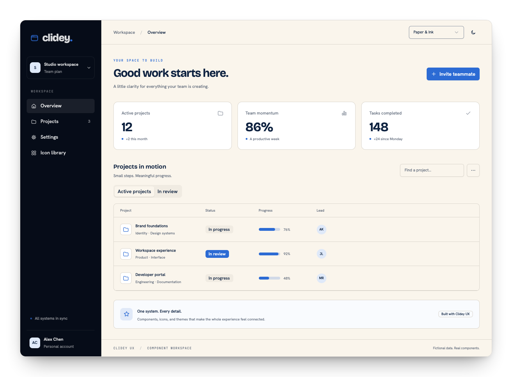

<p align="center">
  
</p>

<h1 align="center">One system. Every product.</h1>

<p align="center">
  Composable React components. 30 complete theme palettes. One shared icon language.<br />
  A shared foundation for product interfaces, from simple forms to data workspaces.
</p>

<p align="center">
  <a href="https://www.npmjs.com/package/@clidey/ux"></a>
  <a href="./LICENSE"></a>
  
  
</p>

<p align="center">
  <a href="https://ux.clidey.com">Interactive catalog</a> ·
  <a href="https://clidey.github.io/ux/">Documentation</a> ·
  <a href="./examples/workspace">Workspace example</a> ·
  <a href="./docs/guides/mcp.mdx">MCP & AI workflows</a>
</p>



Clidey UX is the shared design system for React products. It brings together Radix-backed controls, semantic design tokens, theme-aware data surfaces, and a catalog of 489 SVG icons. You keep ownership of product behavior; the library gives your interfaces a consistent foundation.

The screenshots in this README come from the working [workspace example](./examples/workspace) with fictional data and real UX components.

## A theme changes the whole experience

A primary color is one decision. A product's character comes from how all its decisions work together.

UX's **30 palettes** coordinate surfaces, typography, accents, shape, and motion. Mode is independent: choose a palette once, then offer light, dark, or system preference without maintaining another component tree.



```tsx
import { ThemeProvider, Button, IconArrowRight } from '@clidey/ux';
import '@clidey/ux/styles.css';
import '@clidey/ux/theme-fonts.css'; // Optional, self-hosted palette typefaces

export default function App() {
  return (
    <ThemeProvider defaultPalette="paper-ink" defaultTheme="system">
      <Button>Start building <IconArrowRight /></Button>
    </ThemeProvider>
  );
}
```

Switch palettes with `useTheme().setPalette('forest-moss')`. Read the catalog from `themes` rather than duplicating palette metadata in your app. Use semantic tokens in custom layouts so the whole interface follows along.

[Explore palettes](./docs/theming/palettes.mdx) · [Understand tokens](./docs/theming/tokens.mdx) · [Typography and motion](./docs/theming/typography.mdx)

## Install and compose

```sh
pnpm add @clidey/ux
```

React and React DOM **18.3 or later** are peer dependencies. Import `@clidey/ux/styles.css` once at your application's entry point. The components arrive styled; your own Tailwind setup is only needed for utility classes you add to application markup.

```tsx
import {
  Button, Card, CardHeader, CardTitle, CardDescription,
  CardContent, CardFooter, Input, Label,
} from '@clidey/ux';

export function WorkspaceCard() {
  return (
    <Card>
      <CardHeader>
        <CardTitle>A place for your team</CardTitle>
        <CardDescription>Give your workspace a name.</CardDescription>
      </CardHeader>
      <CardContent>
        <Label htmlFor="workspace">Workspace name</Label>
        <Input id="workspace" placeholder="Studio" />
      </CardContent>
      <CardFooter>
        <Button type="button">Create workspace</Button>
      </CardFooter>
    </Card>
  );
}
```

Connect the action to your application state or API. Composition keeps domain logic in your product rather than hiding it behind a framework.

[Installation](./docs/getting-started/installation.mdx) · [Next.js and Vite](./docs/guides/frameworks.mdx) · [Composition](./docs/guides/composition.mdx)

## The building blocks

| Area | Components and capabilities |
| --- | --- |
| Actions | Button variants, loading states, ButtonGroup, CopyButton |
| Forms | Input, TextArea, Checkbox, Switch, Select, SearchSelect, MultiSearchSelect |
| Navigation | Sidebar, Tabs, Breadcrumb, Pagination, Command |
| Context | Dialog, Sheet, Drawer, Popover, Tooltip, DropdownMenu, ContextMenu |
| Feedback | Alert, Badge, Progress, Spinner, Skeleton, Toaster, EmptyState |
| Layout | Card, Accordion, ResizablePanelGroup, MasterDetailPanels, ScrollArea, StackList |
| Data | Tables, virtualized rows, Tree, Recharts integration, MapLibre layers |
| Product details | FormSheet, ConfirmDialog, Kbd, animated NotFoundPage |
| Foundations | ThemeProvider, palette catalog, semantic tokens, SVG catalog |

Subcomponents give you control over structure. TypeScript declarations describe the public API. Radix-backed primitives handle focus and keyboard behavior; your product still supplies meaningful labels, readable content, and accessible composition.

[Browse the component references](./docs/components/overview.mdx) · [Accessibility guide](./docs/guides/accessibility.mdx)

## One icon language

Use the UX catalog directly in your application:

```tsx
import { Button, IconSearch, CatalogIcon } from '@clidey/ux';

<Button size="icon" variant="ghost" aria-label="Search">
  <IconSearch size={20} />
</Button>
<CatalogIcon name="folder" size={20} />
```

Named React icons inherit text color and accept SVG props and refs. Raw SVG URLs are also available from `@clidey/ux/icons` for non-React surfaces. Validate dynamic names before passing them to `CatalogIcon`.

[Icon catalog guide](./docs/guides/icons.mdx) · [SVG assets](./icons/README.md)

## Build with Claude or Codex

Give a coding agent the complete UX build context and describe your app. The context includes setup, component guides, public types, all icons and palettes, and full working examples.

```text
Read https://clidey.github.io/ux/llms.txt and build the following app using Clidey UX:

[Describe your app.]
```

The public URL works with local and remote coding agents. The Quick Start copy button uses the current host automatically.

```sh
pnpm docs:setup      # prepare the pinned Dory source compiler
pnpm docs:build
pnpm docs:preview
```

Reading `llms.txt` requires no MCP setup. Dory's preview server also exposes read-only MCP at `/ux/mcp` for structured searches and page lookups. Static hosting serves the text files; a live MCP endpoint requires the Dory server.

[Copy the starter prompt](./docs/ai/starter-prompt.txt) · [AI and MCP guide](./docs/guides/mcp.mdx)

## Explore locally

```sh
pnpm install --frozen-lockfile --ignore-scripts
pnpm generate:icons
pnpm dev             # Interactive component catalog
pnpm dev:examples    # Workspace example on port 3190
pnpm docs:dev        # Dory dev server on port 3000, under /ux/
```



## Develop and contribute

Use the pnpm version pinned in `package.json`. Source components live in `src/components/ui/`; exports live in `src/index.ts`. Add behavior tests and documentation alongside public API changes.

```sh
pnpm lint
pnpm test:coverage
pnpm build:lib
pnpm docs:check
pnpm docs:build
```

The showcase and library builds both use root `dist/`. Documentation is an isolated private workspace and builds to `docs/dist/`. Keep lifecycle scripts disabled as configured, and review the generated site before a push or release.

[Development guide](./docs/contributing/development.mdx) · [Documentation workflow](./docs/contributing/documentation.mdx) · [Report an issue](https://github.com/clidey/ux/issues)

## License

[Apache License 2.0](./LICENSE). Included fonts retain their own bundled licenses.
