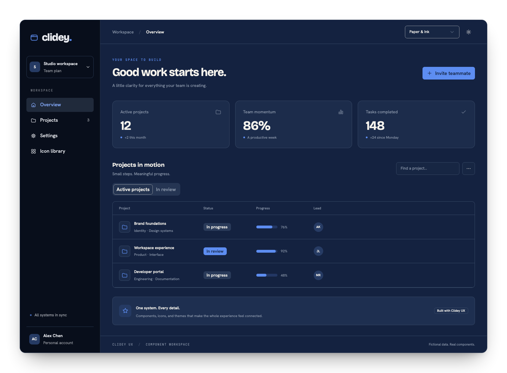
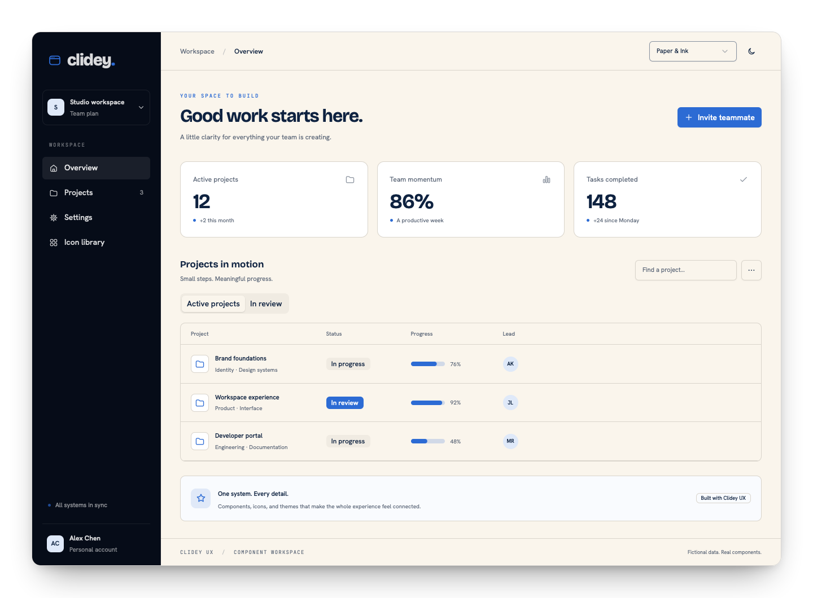
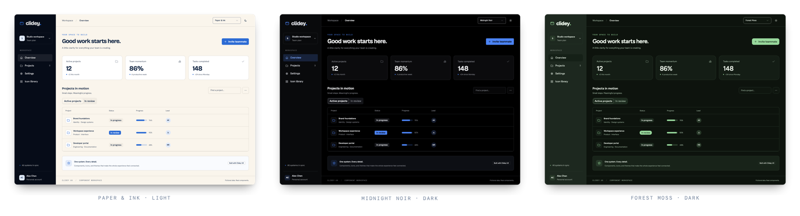
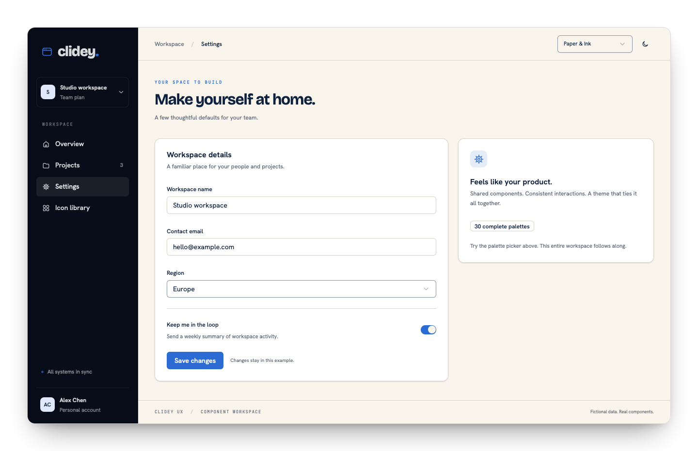
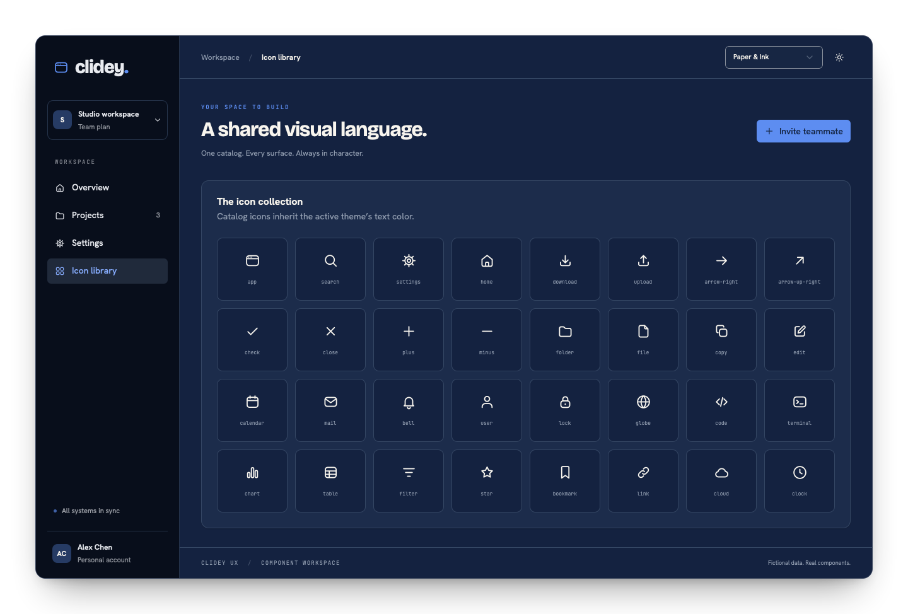
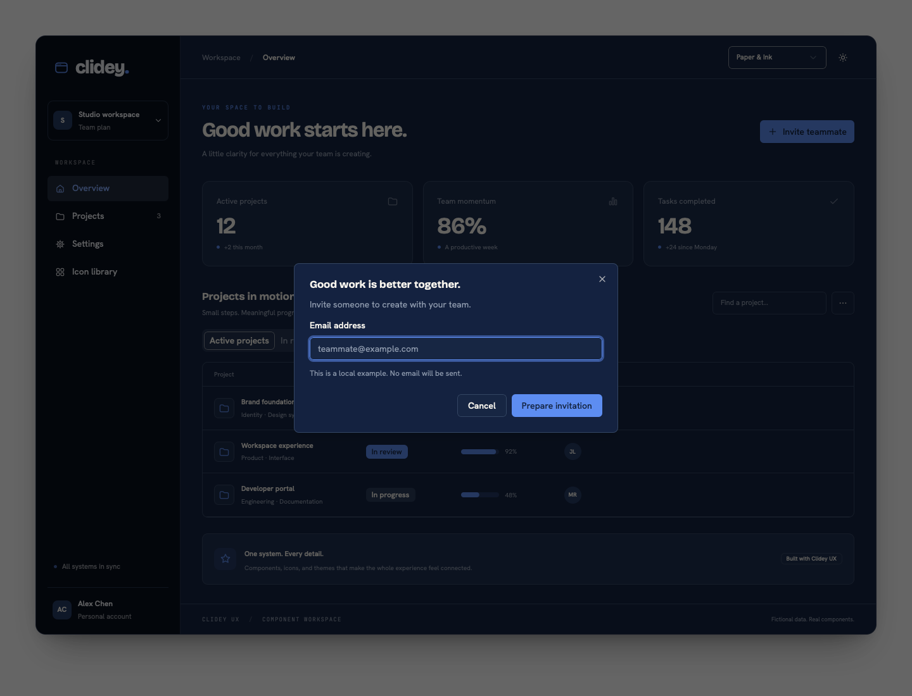

import { ComponentShowcase } from '../examples/live-components.tsx';

These are screenshots of the working [workspace example](https://github.com/clidey/ux/tree/main/examples/workspace), using UX components, the shared icon catalog, and semantic theme tokens. The screenshots use fictional data.


## Try the components

<ComponentShowcase />


## A workspace that follows the theme



The example combines cards, badges, a progress bar, tabs, table rows, tooltips, a menu, and an invitation dialog. Its navigation and actions are functional demonstrations.

## Light is a first-class mode



## Same composition, different character



Palette changes affect surfaces, text, accent colors, and typography. The data and component hierarchy stay the same.

## Forms that belong to the product



The settings view composes labels, inputs, select, switch, and a save action. Saving updates local example state; it does not contact a backend.

## One icon language



## A contextual decision



## Try it locally

```bash
pnpm install --frozen-lockfile --ignore-scripts
pnpm dev:examples
```

Open `http://127.0.0.1:3190/examples/workspace/`. Switch the palette and mode, open the invitation dialog, navigate the views, and try keyboard navigation. The example is for exploration; it does not connect to a production service.
