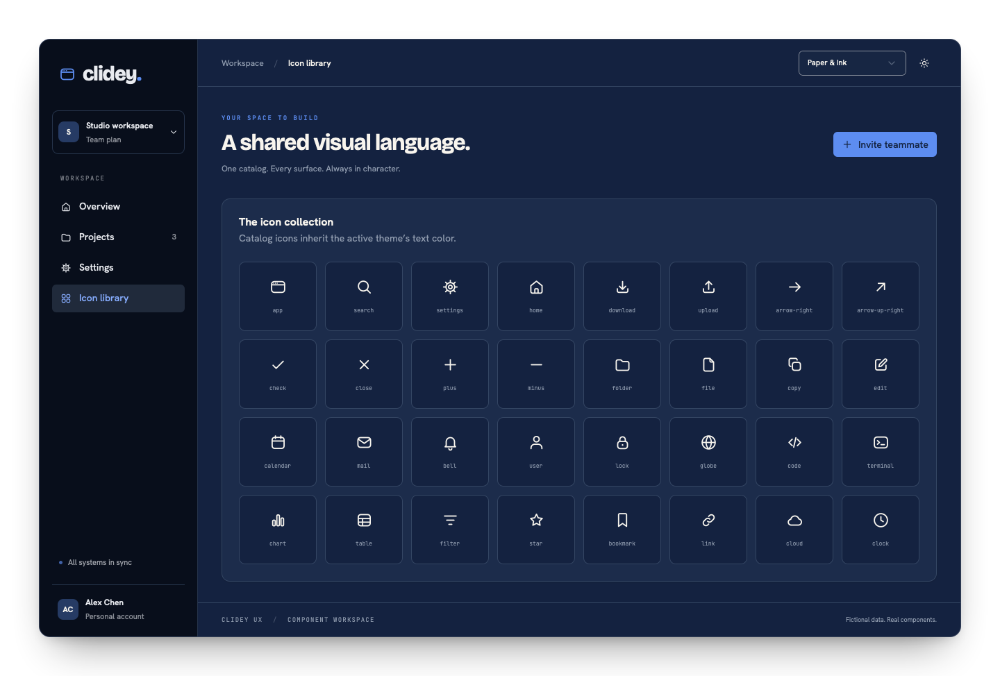

import { IconDemo } from '../examples/live-components.tsx';

The package includes 489 catalog entries. Use named React components for fixed icons, `CatalogIcon` for a dynamic name, or the asset entry point for raw SVG URLs. Applications can use the UX catalog directly without adding another icon dependency.




## Try the catalog

<IconDemo />


## Named React icons

```tsx
import { Button, IconSearch, IconDownload } from '@clidey/ux';

<Button variant="outline"><IconDownload /> Export</Button>
<Button variant="ghost" size="icon" aria-label="Search">
  <IconSearch size={20} />
</Button>
```

Named icons accept standard SVG attributes, a numeric `size` (24 by default), and refs. They inherit `currentColor`; use the surrounding text color or `className` to change them.

## Dynamic names

```tsx
import { CatalogIcon } from '@clidey/ux';
import { icons } from '@clidey/ux/icons';

function NavigationIcon({ name }: { name: string }) {
  const safeName = Object.hasOwn(icons, name) ? name : 'app';
  return <CatalogIcon name={safeName} size={20} />;
}
```

Unknown catalog names throw. Validate values from APIs, user settings, or stored data before rendering them. The URL map is also useful for building a searchable picker.

## SVG assets

```tsx
import searchUrl from '@clidey/ux/icons/svg/search.svg?url';
import { icons } from '@clidey/ux/icons';


```

The `?url` suffix is a Vite feature. In another bundler, use its SVG asset handling or copy individual SVG files to public assets. The asset entry point does not require React. An SVG loaded through an image does not inherit its parent's text color; use the React catalog for theme-colored UI icons.

## Naming and alternatives

Catalog keys use lowercase hyphenated names such as `arrow-right`. React exports use the `Icon` prefix and PascalCase: `IconArrowRight`. Distinct artwork with a shared base name has an `-alt` suffix and a corresponding `Alt` export.

Use the [interactive catalog](https://ux.clidey.com/#iconography) to browse names. The [generated component file](https://github.com/clidey/ux/blob/main/scripts/build-icon-components.mjs) derives named exports from the same source catalog.

## Accessibility

Decorative catalog icons are hidden from assistive technology by default. Label the control when the icon is its only content. If an icon communicates information on its own, give the icon an `aria-label`. Pair status colors with visible words.

`Icon` is a separate wrapper for presentation variants (`plain`, `subtle`, and `solid`); see the [Icon reference](/components/icon).
