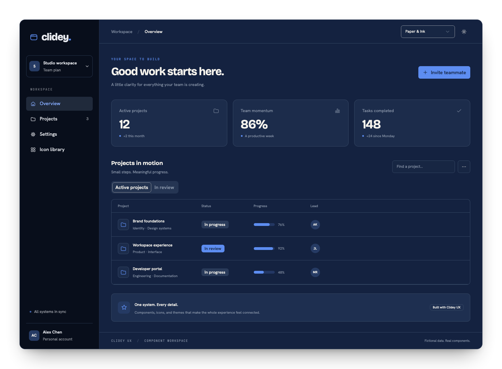
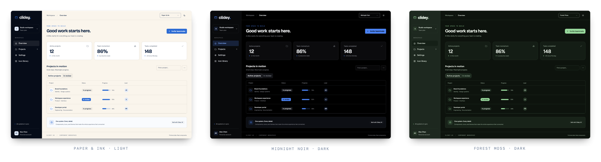

Clidey UX gives React applications a shared visual language: composable components, **30 complete theme palettes**, and a **489-icon catalog**. Build an interface once, then change its atmosphere without rebuilding its behavior.

<Card title="Build your app with Claude or Codex" href="/getting-started/quick-start" description="Copy one prompt with the complete UX context, describe your app, and start building." />



The workspace above uses the actual package components. Its data is fictional; the [example source](https://github.com/clidey/ux/tree/main/examples/workspace) is included in this repository.

## A palette changes more than a button

Surfaces, typography, focus rings, charts, navigation, shape, and motion belong to the same system. A palette gives these decisions a shared direction. Light and dark remain independent choices.



```tsx
import { ThemeProvider } from '@clidey/ux';
import '@clidey/ux/styles.css';
import '@clidey/ux/theme-fonts.css';

<ThemeProvider defaultPalette="paper-ink" defaultTheme="system">
  <App />
</ThemeProvider>
```

## What you can build

| Need | Start with |
| --- | --- |
| Product actions and forms | Button, Input, Select, SearchSelect, Checkbox, Switch |
| Application navigation | Sidebar, Breadcrumb, Tabs, Command |
| Decisions and contextual editing | Dialog, Sheet, Drawer, Popover, ConfirmDialog |
| Data workspaces | Table with automatic row windowing, Tree, MasterDetailPanels |
| Visual feedback | Alert, Badge, Progress, Skeleton, Toaster |
| Visualization | ChartContainer and MapContainer |
| A consistent visual identity | ThemeProvider, semantic tokens, CatalogIcon |

## A useful starting point for people and agents

Guides cover setup, framework integration, accessible composition, and theme design. Component references include imports, examples, and API details. Dory also publishes machine-readable documentation and can expose these guides through MCP when served with its preview server.

<CardGroup cols={2}>
  <Card title="Start building" href="/getting-started/installation" description="Install the package, load styles, and render your first interface." />
  <Card title="Explore the themes" href="/theming/palettes" description="Understand the palette catalog and change your app as a whole." />
  <Card title="Find a component" href="/components/overview" description="Browse actions, forms, navigation, overlays, and data components." />
  <Card title="Work with MCP" href="/guides/mcp" description="Give your coding tools the actual component and theme documentation." />
</CardGroup>

Clidey UX is open source under [Apache 2.0](https://github.com/clidey/ux/blob/main/LICENSE). React and React DOM 18.3 or later are required.
