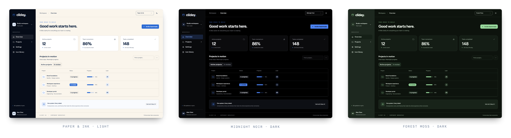

import { ThemeDemo } from '../examples/live-components.tsx';

A palette is a coordinated set of decisions, rather than a primary color. UX packages surfaces, contrast, typography, shape, and motion together so an entire interface can change direction coherently.



These captures use the same workspace and data. Only the palette and color mode change.


## Try a palette

<ThemeDemo />


## Choose a default

```tsx
import { ThemeProvider } from '@clidey/ux';
import '@clidey/ux/styles.css';
import '@clidey/ux/theme-fonts.css';

<ThemeProvider defaultPalette="forest-moss" defaultTheme="dark">
  <App />
</ThemeProvider>
```

`defaultPalette` is used when there is no valid saved palette. `defaultTheme` similarly supplies the initial mode. Existing choices in local storage take precedence.

## Let the user choose

```tsx
import {
  Select, SelectTrigger, SelectValue, SelectContent, SelectItem,
  themes, useTheme,
} from '@clidey/ux';

export function PalettePicker() {
  const { palette, setPalette } = useTheme();
  return (
    <Select value={palette ?? 'default'}
      onValueChange={value => setPalette(value === 'default' ? null : value)}>
      <SelectTrigger aria-label="Color palette"><SelectValue /></SelectTrigger>
      <SelectContent>
        <SelectItem value="default">Default tokens</SelectItem>
        {themes.map(theme => (
          <SelectItem key={theme.id} value={theme.id}>{theme.name}</SelectItem>
        ))}
      </SelectContent>
    </Select>
  );
}
```

Keep this picker inside `ThemeProvider`. Mode and palette have separate persistence keys, so someone can prefer Forest Moss and still follow their operating system's light/dark setting.

## The catalog

| Palette ID | Name |
| --- | --- |
| paper-ink | Paper & Ink |
| midnight-noir | Midnight Noir |
| arctic-steel | Arctic Steel |
| obsidian-vault | Obsidian Vault |
| nordic-frost | Nordic Frost |
| ice-crystal | Ice Crystal |
| newspaper-gothic | Newspaper Gothic |
| tokyo-zen | Tokyo Zen |
| velvet-rose | Velvet Rose |
| desert-sandstone | Desert Sandstone |
| cyber-matrix | Cyber Matrix |
| hologram-hud | Hologram HUD |
| retro-amber | Retro Amber |
| midnight-raid | Midnight Raid |
| berlin-techno | Berlin Techno |
| brutalist-concrete | Brutalist Concrete |
| neon-tokyo | Neon Tokyo |
| vapor-synth | Vapor Synth |
| candy-pop | Candy Pop |
| seoul-neon | Seoul Neon |
| sao-paulo-carnival | São Paulo Carnival |
| aurora-glass | Aurora Glass |
| deep-ocean | Deep Ocean |
| sydney-surf | Sydney Surf |
| forest-moss | Forest Moss |
| ember-forge | Ember Forge |
| mars-colony | Mars Colony |
| solar-gold | Solar Gold |
| mumbai-spice | Mumbai Spice |
| sahara-dusk | Sahara Dusk |

## Inspect the definition

```tsx
import { getThemeById } from '@clidey/ux';

const palette = getThemeById('paper-ink');
console.log(palette?.typography, palette?.motion, palette?.surface);
```

`ThemeDefinition` includes `id`, `name`, `description`, `personality`, `css`, `className`, `dataAttr`, `typography`, `motion`, and `surface`. Read metadata from the catalog instead of keeping a second list in your application.

## Outside React

```css
@import '@clidey/ux/theme-palettes.css';
@import '@clidey/ux/theme-fonts.css';
```

```js
const root = document.documentElement;
root.classList.add('theme-paper-ink', 'dark');
root.dataset.theme = 'paper-ink';
```

Remove the previous palette class when switching. These assets share the React catalog's semantic tokens; they do not provide React components or a preference persistence layer.

## Make the change meaningful

Use semantic classes such as `bg-background`, `text-foreground`, and `border-border` in product layouts. A hardcoded white card or gray text will not follow the palette. Test the actual content in both modes: a palette does not replace contrast, focus, chart-legibility, or reduced-motion checks.
